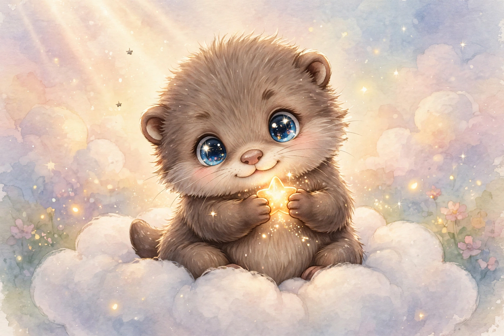

# Starlight Otter

Entry for the make.fun **cutest-picture-01** bounty ("Make the cutest picture").



A fluffy baby otter with enormous galaxy-blue eyes sits on a pillowy cloud at dawn, cradling a glowing golden star in both paws. Soft pastel watercolor skies, drifting sparkles, and tiny wildflowers frame the little creature in a dreamy storybook glow. The piece is a digital painting generated with an AI image pipeline, then resized to fit the bounty's output limits in full color.

## How it runs

```
python3 main.py
```

`main.py` (Python 3, standard library only, no network) copies the bundled `art.png` to `/output/entry.png`. The output is deterministic — byte-identical on every run — and measures 1024 × 683 px at 949,305 bytes, inside the ≤1024 × 1024 px and ≤1 MiB limits.

## License

MIT — see `LICENSE`.
